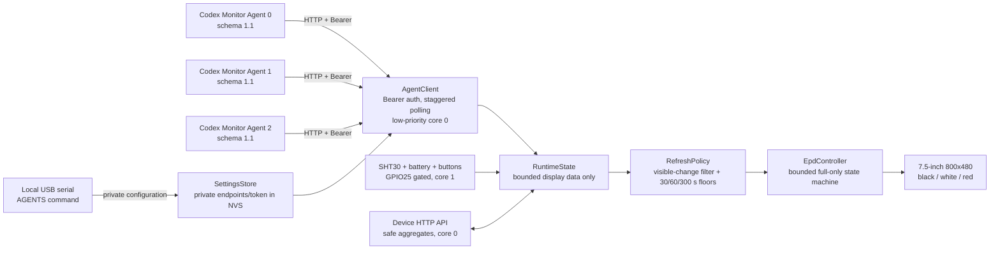

# Epaper75 0.5.1 architecture and feasibility

## System boundary



The three desktop Agents are the data sources. The ESP32 is a read-only fleet
dashboard and a small device API; it does not read Codex files or credentials
from a desktop directly and it does not approve or answer tasks.

All three Agent installations use one Codex account. Account quota is therefore
one shared snapshot, while workload, thread and action state remain separate
per installation. Slot 0 is the fixed preferred account source; another
identity-verified Agent can provide fallback quota data.

The retired `0.3.x` desktop Bridge and its `GET /status` payload are outside the
current system. `docs/BRIDGE_PROTOCOL.md` exists only to keep historical links
valid.

## Firmware layers and tasks

| Layer | Responsibility |
|---|---|
| `board` | Safe GPIO startup, GPIO25-gated SHT30 and battery ADC, debounced semantic buttons |
| `net` | NVS settings, Wi-Fi provisioning, authenticated three-Agent client, device HTTP API |
| `app` | Fixed-size shared model, semantic revision tracking, conservative refresh scheduling |
| `ui` | Fleet/System rendering and the only physical e-paper refresh entry point |

`DeviceServer` runs on Core 0 at priority 2. `AgentClient` is a low-priority
Core 0 task. Button scanning and the display state machine run from the Arduino
main loop on Core 1. A long full-screen physical waveform can pause button
scanning, but it does not directly block the Core 0 HTTP or Agent tasks.

HTTP handlers expose read-only aggregates and never call the display. Agent
endpoints, the shared Bearer token and the learned, NVS-pinned installation
identities stay in `SettingsStore`/`AgentClient`. Only bounded,
display-safe labels, task text, counts, enum states and timestamps enter
`RuntimeState`.

The legacy four-site DNS + TCP/443 `NetworkProbe` source remains available for
historical diagnostics but is not started by `0.5.1-p1`. No probe task writes
`RuntimeState`, no latency is rendered or returned by the device API, and
latency jitter cannot trigger a physical refresh.

## Agent client

The client targets Codex Monitor Agent `0.4.x` schema `1.1`. It sends
`Authorization: Bearer <token>` on every request and uses bounded streaming JSON
parsers. It verifies schema major 1 and captures a stable `installation_id`
through `GET /api/v1/version` before trusting `GET /api/v1/status`.

One configured slot is polled every five seconds, so each of the three Agents
is normally visited about every 15 seconds. If status reports known active
threads, the same slot also requests `GET /api/v1/threads?limit=12`. Candidate
task priority is approval, input, running, then error; equal-priority tasks use
the most recent `updated_at`. Display text is normalized into a fixed ASCII
buffer.

Account `GET /api/v1/rate-limits` is polled on a 60-second cadence. A quota cycle
starts at fixed primary slot 0 and falls back through the other slots even when
the primary Agent's version/status request fails.
The parser accepts a 6-to-8-day window from `rateLimits.primary` or
`rateLimits.secondary`, treats `usedPercent` as used capacity, and stores the
epoch `resetsAt`. The UI displays `100 - usedPercent` and formats reset as an
absolute UTC+8 time.

Transport failures first enter recovery and become offline after three
consecutive failures. Wi-Fi loss immediately makes configured slots offline.
HTTP 401 locks the slot as an auth error until settings change. Incompatible
schema or a changed installation identity locks it as a protocol error until
settings change. Unknown, unavailable, stale, idle and offline remain distinct
states.

The complete consumed-field and provisioning contract is in
`../../docs/AGENT_PROTOCOL.md`.

## Home and System pages

Home is a flat two-column composition:

- Left: shared Codex account, Weekly remaining percentage/bar, absolute reset
  time, primary/fallback source label, availability and source update time.
- Right: three Agent rows with live workload, current task, workflow/worker
  counts, waiting/error/run counts, activity age and action-required emphasis.
- Header: `CODEX FLEET`, Wi-Fi icon and live `N/3` only. Battery and the retired
  Bridge icon are not shown.

`N/3` counts only identity-verified, online, non-stale Agents. It is not the
number of configured endpoints. Red is limited to the title accent, low quota,
action-required and error/offline states.

Temperature, humidity, approximate battery percentage/voltage, firmware and
connectivity details remain on System. Home has no IP/subtitle row, button
legend or bottom help copy.

## Display lifecycle and refresh planning

The pinned GxEPD2 Z08 driver advertises partial-window support, but physical
testing on this recovered panel produced persistent half-screen shadowing after
repeated partial updates. `0.5.1-p1` therefore treats the hardware as full-only;
the library capability flag is not sufficient evidence to enable partial mode.
The upstream full driver uses a `void` BUSY wait that merely logs a timeout, so
the product firmware supplies a project-specific bounded path:

```text
Unknown / PoweredOff
        -> bounded recovery wait when prior state is uncertain
        -> hardware reset + init
        -> full-width page writes
           (0x91/0x90, black 0x10, red 0x13, 0x92)
        -> one full refresh 0x12 with a bounded BUSY wait
        -> bounded power-off 0x02
        -> PoweredOff

Any failure -> one reset/recovery attempt -> FaultLocked
```

The RTC journal uses a magic value and checksum in `RTC_NOINIT_ATTR`. It can
survive deep sleep and resets that leave the RTC domain intact. EN/CHIP_PU,
brownout, or full power loss may erase it; those cases become `Unknown` and use
the conservative BUSY wait plus reset path. It is deliberately not written to
NVS on every refresh, avoiding unnecessary flash wear.

`RefreshPolicy` compares the desired model with the last successfully displayed
model and ignores fields that are not visible on the current page. It also
continues to suppress timestamp-only and RSSI jitter. Routine visible changes
are accumulated behind a five-minute floor, new approval/input/offline/error
transitions use a 60-second floor, and page changes or explicit cleanup use a
30-second floor. The first complete model is displayed after the normal startup
grace without waiting five minutes. Every successful refresh ends with a
bounded power-off and released SPI pins.

## Device API

| Method | Path | Current behavior |
|---|---|---|
| GET | `/api/info` | API/firmware/display metadata plus safe Wi-Fi, Agent and account aggregates |
| GET | `/api/health` | Uptime, heap and safe Wi-Fi/Agent/account health aggregates |

`/api/info` reports API version 2 and `showing=agent_fleet` or `system`. Neither
read endpoint returns Agent hosts, token, installation IDs, device IP, SSID or
MAC. There are no HTTP write routes; configuration, page changes and manual
refresh remain local to USB serial or the physical buttons.

## Provisioning and buttons

- Stored ESP32 Wi-Fi credentials are reused and never erased automatically.
- If initial connection has not succeeded after 12 seconds, WiFiManager opens
  the non-blocking AP `Epaper75-Setup`.
- After the device has connected once, a later disconnect uses automatic
  reconnect and does not reopen the portal or compete with the device API for
  port 80.
- Three Agent endpoints and their shared token are accepted only through the
  local USB serial command
  `AGENTS <endpoint0> <endpoint1> <endpoint2> <token>`. Slot 0 is always
  primary; the command and arguments must never be logged or echoed.
- Right-side top-to-bottom order after the power switch: EN reset, Upper
  GPIO34, Middle GPIO35, Lower GPIO39.
- Short press: Upper next page, Middle rate-limited refresh, Lower back.
- Long press: Upper immediate Agent poll, Middle System page, Lower Home.

## Feasibility verdict

| Area | Verdict | Remaining proof |
|---|---|---|
| ESP32 firmware and panel | Feasible with full refresh only | Visually accept shadow removal and continue refresh-interrupt tests for `0.5.1-p1` |
| Three authenticated Agents | Feasible, implemented | Verify all reachable LAN routes, schema/identity locks, and one-Agent-offline degradation |
| Shared Weekly account quota | Feasible, implemented | Confirm primary-first and fallback behavior with live CMA data |
| Fleet UI | Feasible within e-paper constraints | Physical 800x480 visual acceptance and long-task truncation check |
| SHT30, battery, buttons | Feasible and P0-proven | Battery calibration and enclosure temperature bias remain |
| Animation/high-rate charts | Not suitable for this panel | Deliberately excluded |
| Battery productization | Not yet proven | Current draw, low-voltage cutoff, sleep and runtime tests |

The project remains technically viable. The dominant constraints are slow
full refresh, physically unacceptable partial-window behavior, no PSRAM,
plain-HTTP Agent transport on a trusted LAN, one
potentially unroutable Agent network, uncalibrated battery measurement, and
unmeasured panel high-voltage behavior under a forced BUSY fault.
