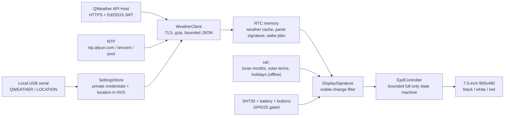

# Epaper75 0.6 architecture

## System boundary



The device is a calendar and weather display. It talks to exactly two kinds of
external services: the account-specific QWeather API Host and NTP. There is no
device HTTP server, no Agent client, and no network configuration endpoint.

## Firmware layers

| Layer | Responsibility |
|---|---|
| `board` | Safe GPIO startup, GPIO25-gated SHT30 and battery ADC, debounced buttons |
| `cal` | Offline Gregorian/lunar calendar, 24 solar terms, festivals, statutory holiday table |
| `weather` | Condition-code text and icon table, wind and AQI wording |
| `net` | NVS settings, Wi-Fi connect/portal, NTP, QWeather client (JWT, TLS, gzip, parsers) |
| `app` | Display model, visible-content signature, wake schedule |
| `ui` | Bitmap fonts, icons, renderer, and the only panel-refresh entry point |

Everything runs on the Arduino loop task. Each boot is a short, sequential job
that always ends in deep sleep:

```text
timer wake ─► early? sleep again
           ─► low battery? draw low-battery mark (if changed), sleep 6 h
           ─► Wi-Fi ─► NTP ─► fetch (full, or alerts then full if changed)
           ─► radio off ─► redraw only if visible signature changed ─► sleep

button / power-on / EN ─► interactive window (90 s after last activity):
           buttons, USB serial commands, optional Wi-Fi portal
           ─► return to Home (redraw if needed) ─► sleep
```

See [`../../docs/POWER.md`](../../docs/POWER.md) for the wake table, failure
handling and energy estimate.

## State across deep sleep

`RtcState` (`RTC_DATA_ATTR`) keeps the last weather snapshot, resolved place
name, the signature and page of the image currently on the panel, the next
wake epoch/kind and the retry counter. It is reset on power loss or EN. The
system clock survives deep sleep on the RTC timer and is re-synchronised on
every network session. The EPD journal keeps its own `RTC_NOINIT_ATTR` record
as before.

Persistent NVS (namespace `ep75_p1`) holds the QWeather credential blob
(CRC-checked), the packed coordinates, and the cached GeoAPI place name. The
Wi-Fi driver's own namespace is never touched.

## Rendering

The renderer uses generated 1-bit fonts rasterised from Noto Sans SC (SIL OFL
1.1) by `tools/gen/gen_fonts.sh` (CoreText on macOS). Two fonts contain all
3755 GB2312 level-1 characters so API-provided place names render; the others
contain only the characters used in source code, which the script collects
automatically. Text is drawn as horizontal runs through `Adafruit_GFX`, so the
same code runs on the panel and in the host preview.

Home page: header (place, update time or alert banner, low-battery
mark, Wi-Fi state), today panel (date, weekday, lunar date, festival/solar
term/holiday chips, ISO week), current weather (icon, temperature, condition,
high/low, feels-like), a 3×2 facts grid (wind, AQI, humidity, sunrise, sunset,
today's precipitation chance), a Monday-first month calendar with lunar labels and
休/班 marks, and a six-day forecast strip.

System page: approximate battery, voltage, next wake, wake count, wake
duration, last fetch result/time, alerts, Wi-Fi, firmware and refresh mode.
Indoor temperature/humidity are not displayed and the SHT30 is not sampled;
only the battery divider is gated on for each wake.

Red is reserved for: title accent, today, weekend headers, festivals and solar
terms, 休 marks, the sun, severe weather, poor AQI, alerts, stale/failed data
and low battery.

`tools/preview/build_preview.sh` compiles the real renderer with Adafruit GFX
on the host and writes 800×480 PNGs for review before any flash.

## Display lifecycle

Unchanged from 0.5.1: the recovered panel is full-refresh only. Physical
testing of partial-window refresh produced persistent half-screen shadowing.

```text
Unknown / PoweredOff
        -> bounded recovery wait when prior state is uncertain
        -> hardware reset + init
        -> full-width page writes
        -> one full refresh with a bounded BUSY wait
        -> bounded power-off
        -> PoweredOff

Any failure -> one reset/recovery attempt -> FaultLocked
```

A fault-locked panel is never retried automatically; wakes continue to fetch
data but skip the panel. A minimum 10 s gap separates interactive refreshes.

## Calendar data

`include/cal/CalendarData.h` is generated by `tools/gen/gen_calendar.swift`:
lunar month starts from the ICU Chinese calendar (verified on the host against
Foundation for every day 2025–2035) and solar terms from the Meeus apparent
solar longitude. Terms within 45 minutes of midnight were checked against
published almanac times. The statutory holiday table in `src/cal/Calendar.cpp`
covers 2026 and 2027 and must be extended each November when the State Council
publishes the next schedule. Outside 2025–2035 the calendar still shows
Gregorian dates without lunar data.
