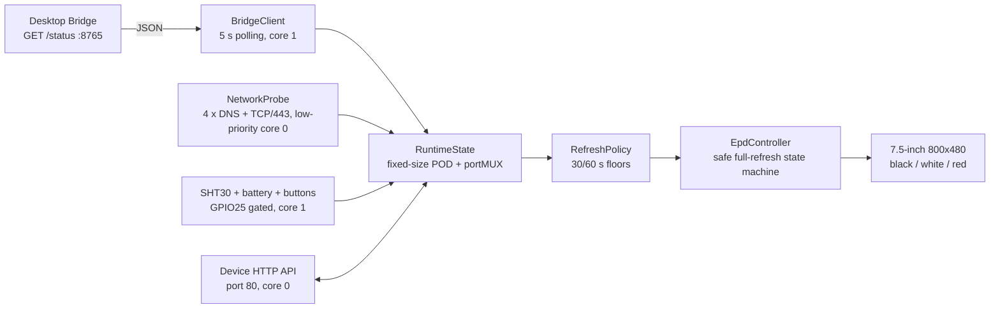

# Epaper75 P1 architecture and feasibility

## System boundary



The desktop Bridge is the data source and the ESP32 is the display and device
API. The Bridge's existing status collection and `GET /status` JSON remain
unchanged. TFT, GIF, RGB565 animation, backlight, music, and high-frequency
network charts from the sample device are intentionally outside P1.

## Firmware layers

| Layer | Responsibility |
|---|---|
| `board` | Safe GPIO startup, GPIO25-gated SHT30 and battery ADC, debounced semantic buttons |
| `net` | NVS settings, non-blocking Wi-Fi provisioning, Bridge JSON client, four-site TCP latency probe, core-0 device API |
| `app` | Fixed-size shared model, semantic revision tracking, conservative refresh scheduling |
| `ui` | Dashboard/system rendering and the only physical e-paper refresh entry point |

The HTTP task never calls the display. It only changes cached state or queues a
refresh, so `/api/info` remains available during a roughly 21-second panel
refresh. Outgoing Bridge polling and physical buttons still share the Arduino
main loop and pause during the refresh; moving them to their own task is a P2
improvement, not a P1 safety requirement.

Bridge connect and read phases are bounded to approximately three seconds in
total. A transient HTTP error is recorded immediately, but an established
Bridge is shown offline only after three consecutive failures; Wi-Fi loss,
endpoint removal, and endpoint replacement remain immediate transitions.

The network probe performs no TLS or HTTP transfer. Each result is the elapsed
time for DNS resolution plus a plain TCP connection to port 443, bounded to
1.2 seconds. Wi-Fi connection triggers a fast four-site warm-up; steady-state
sampling is one target every 15 seconds, or about once per minute per site.
Only one connection attempt is made from a task iteration. The probe owns a
low-priority Core 0 task so DNS or TCP delay cannot block Core 1 button scans;
the Core 0 HTTP task has higher priority.

Raw latency is always cached. Reachability and quality-band transitions bump
the display revision immediately; otherwise one completed-round bucket out of
five forces an exact-value redraw. This keeps the network page current on an
e-paper timescale without turning small Wi-Fi jitter into near-continuous full
refreshes.

The home page consumes only Codex fields from the Bridge. Bridge percentages
are used percentages, so the renderer clamps and displays `100 - used`. The
minute countdown and Bridge Unix timestamp are converted once into a stable
absolute reset timestamp, then formatted in UTC+8. This avoids the displayed
time creeping forward while the Bridge serves cached quota data.

## Display lifecycle

The upstream GxEPD2 Z08 driver uses a `void` BUSY wait that merely logs a
timeout. P1 therefore supplies a minimal, project-specific full-screen path:

```text
Unknown / PoweredOff
        -> bounded recovery wait when prior state is uncertain
        -> hardware reset + init
        -> page writes (0x91/0x90, black 0x10, red 0x13, 0x92)
        -> full refresh 0x12 with a bounded BUSY wait
        -> bounded power-off 0x02
        -> PoweredOff

Any failure -> at most one reset/recovery attempt -> FaultLocked
```

The RTC journal uses a magic value and checksum in `RTC_NOINIT_ATTR`. It can
survive deep sleep and resets that leave the RTC domain intact. EN/CHIP_PU,
brownout, or full power loss may erase it; those cases become `Unknown` and use
the conservative BUSY wait plus reset path. It is deliberately not written to
NVS on every refresh, avoiding unnecessary flash wear.

Only event-driven full refresh is enabled. Ordinary semantic changes wait at
least 60 seconds; attention transitions and explicit requests still observe a
30-second hard floor. P1 does not enable partial refresh.

## Device API

| Method | Path | P1 behavior |
|---|---|---|
| GET | `/api/info` | Device identity, approximate battery, four latency results, and sample-client compatibility fields |
| GET | `/api/health` | Cached Wi-Fi/Bridge/heap, battery, and probe-round health |
| POST | `/api/bridge` | Form field `host=ip_or_name[:port]`; persist and poll |
| POST | `/api/display` | Form field `mode=auto|claude|codex` |
| POST | `/api/refresh` | Queue a rate-limited refresh; never refresh in handler |

`/api/info` retains `mode`, `sprite_rev: 0`, and `brightness: 100` so the
reference Windows client can discover the device. Its effective page-0 mode is
now `codex`, regardless of the legacy mode setting. GIF/sprite endpoints and a
root configuration web page are not implemented in P1.

## Provisioning and buttons

- Stored ESP32 Wi-Fi credentials are reused and never erased automatically.
- If initial connection has not succeeded after 12 seconds, WiFiManager opens
  the non-blocking AP `Epaper75-Setup`.
- After the device has connected once, a later disconnect uses automatic
  reconnect and does not reopen the portal or compete with the device API for
  port 80.
- Right-side top-to-bottom order after the power switch: EN reset, Upper
  GPIO34, Middle GPIO35, Lower GPIO39.
- Short press: Upper next page, Middle rate-limited refresh, Lower back.
- Long press: Upper immediate Bridge poll, Middle System page, Lower Dashboard.

## Feasibility verdict

| Area | Verdict | Remaining proof |
|---|---|---|
| ESP32 firmware and panel | Feasible, high confidence | P1 full refresh, repeat refresh, refresh-interrupt test |
| SHT30, battery, buttons | Feasible and P0-proven | Battery percentage is voltage-estimated; divider/chemistry calibration and enclosure temperature bias remain |
| Existing Bridge protocol | Feasible, parser implemented | Build Bridge and perform live `/status` exchange |
| Desktop Bridge protocol | Feasible with external reference | Build the pinned Windows or macOS reference, then replace it with an owned authenticated P2 implementation |
| Sample-like visual result | Feasible within e-paper constraints | Typography polish and optional Chinese font later |
| Animation/high-rate charts | Not suitable for this panel | Deliberately excluded |
| Battery productization | Not yet proven | Current draw, low-voltage cutoff, sleep and runtime tests |

The project is technically viable. The dominant product constraints are the
panel's slow full refresh, no PSRAM, uncalibrated battery measurement, and the
still-unmeasured behavior of panel high-voltage rails under a forced BUSY
fault. None prevents the controlled P1 app0 test.
